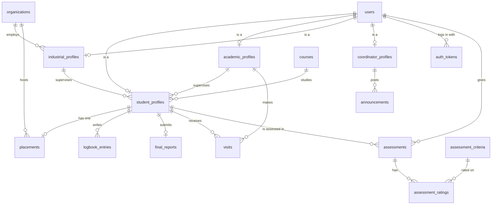

# Langata College – Internship & Attachment database

PostgreSQL 13+ database for the attachment portal frontend (`index.html`, `styles.css`, `app.js`).
It holds everything the frontend currently keeps in the browser's `localStorage`.

| File | What it is |
|---|---|
| `schema.sql` | Tables, constraints, triggers, indexes, reporting views and the default reference data |
| `seed.sql` | Demo accounts and records (same as the frontend's demo data) – **development only** |

## Install

```bash
createdb langata
psql -d langata -v ON_ERROR_STOP=1 -f schema.sql
psql -d langata -v ON_ERROR_STOP=1 -f seed.sql      # optional demo data
```

Everything lives in a schema called `langata`. To start over: `DROP SCHEMA langata CASCADE;` and run the files again.
In your connection settings use `search_path=langata,public` (or prefix table names with `langata.`).

Demo logins (password `demo1234` for all): `student@`, `brian@`, `grace@`, `academic@`, `industrial@`, `coordinator@` + `langata.ac.ke`.

## Tables



| Table | Purpose | Frontend feature |
|---|---|---|
| `users` | One row per person: role, name, email, phone, password hash | Sign up / log in (all 4 roles) |
| `auth_tokens` | Hashed API tokens with expiry | Staying signed in |
| `student_profiles` | Admission no., course, year, assigned academic + industrial supervisor | Student sign-up; coordinator "Students" page |
| `academic_profiles` | Staff no., department | Academic sign-up |
| `industrial_profiles` | Organisation, position | Industrial sign-up |
| `coordinator_profiles` | Staff no. | Coordinator sign-up |
| `courses`, `organizations` | Lookup lists (course dropdown, host companies) | Sign-up and placement forms |
| `placements` | One per student: organisation, dates, status, coordinator comment | Student "My placement"; coordinator "Placements" |
| `logbook_entries` | Weekly entries with hours, status and both supervisors' comments | Student logbook; both supervisors' review pages |
| `final_reports` | One per student; file name/path/size and review status | Student "Final report"; academic review |
| `visits` | Scheduled / completed / cancelled supervisor visits | Academic "Supervisor visits" |
| `assessments` + `assessment_ratings` + `assessment_criteria` | Academic marks and industrial evaluations with the five 1–5 skill ratings | Assessments, Evaluation, Reports |
| `announcements` | Coordinator notices | Announcements card on every dashboard |
| `app_settings` | `target_hours` (400) | Progress bars |

### Views (ready-made queries for the dashboards)

| View | Gives you |
|---|---|
| `v_student_summary` | One row per student: placement status, organisation, approved/logged hours, report status, academic/industrial/overall marks – the data behind the coordinator Reports page and CSV export |
| `v_logbook_details` | Logbook entries joined with student name and both supervisor ids (filter by `industrial_supervisor_id` or `academic_supervisor_id`) |
| `v_supervisors` | Academic and industrial supervisors with their student counts |
| `v_placement_overview` | Students per placement state (`none`, `pending`, `approved`, `rejected`) |

## Rules the database enforces

These match the frontend's behaviour, so bad data is refused even if a bug slips into the app code.

- Emails are unique, lower-case and well-formed; admission and staff numbers are unique.
- A profile can only belong to a user with the right role, and a supervisor column can only point to a real supervisor of that type.
- A student has at most one placement; its end date must be after its start; rejecting needs a written reason.
- Approving a placement stamps the decision time and attaches the placement's industrial supervisor to the student (if none is set).
- Logbook entries are only allowed once the placement is **approved**; one entry per week (1–30); 1–60 hours; rejecting needs a reason; review time is stamped automatically.
- Reports must be PDF/Word and at most 10 MB; only the student's own academic supervisor can mark one reviewed.
- Visits, academic assessments and industrial evaluations must come from the student's assigned supervisor. Marks are 0–100 and skill ratings 1–5, once per skill.
- Deleting a student removes their placement, logbook, report, visits and assessments; supervisors are never deleted by it.

## Using it with a backend

- **Passwords** are stored as hashes (the demo uses bcrypt via `pgcrypto`). Your backend should hash with bcrypt/argon2 and verify in code.
- **Report files** are not stored in the database – only `file_name`, `file_path` and `file_size_bytes`. Keep the files on disk or in object storage and put the location in `file_path`.
- **The coordinator access code** (`LANGATA-COORD` in the frontend) is intentionally *not* in the database; keep it in your backend's environment settings.
- Field names differ slightly from the frontend (`full_name` ↔ `name`, `hours_worked` ↔ `hours`, `week_no` ↔ `week`); map them in your API layer.
