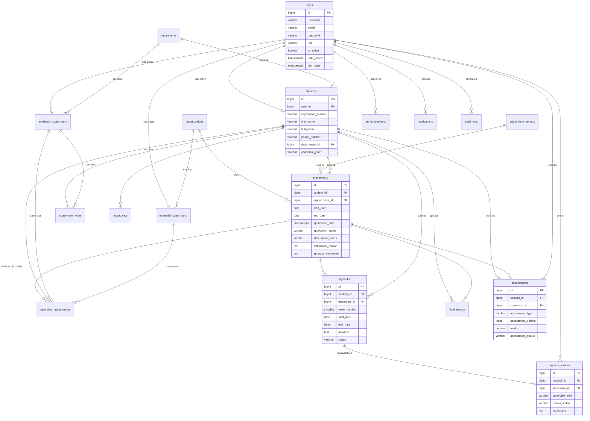

# Database Design

**DBMS:** PostgreSQL · **Database:** `student_internship_management` · **Managed by:** Django ORM migrations

The tables are created by `python manage.py migrate` from the models in `Backend/apps/*/models.py`.
[`schema.sql`](schema.sql) is a generated reference copy of the resulting DDL, and
[`sample_data.sql`](sample_data.sql) loads reference data and an administrator account.

## Tables

| No. | Table | Django model | Description |
|---|---|---|---|
| 1 | `users` | `accounts.User` | Accounts and authentication (username, email, password hash, role, is_active, date_joined, last_login) |
| 2 | `students` | `students.Student` | Registration number, names, phone, department, academic year |
| 3 | `academic_supervisors` | `supervisors.AcademicSupervisor` | Staff number, names, phone, department |
| 4 | `industrial_supervisors` | `supervisors.IndustrialSupervisor` | Organization, employee number, names, phone, job title |
| 5 | `departments` | `accounts.Department` | Department name, code, description |
| 6 | `organizations` | `organizations.Organization` | Host organization directory and status |
| 7 | `placements` | `placements.Placement` | Placement applications, decision, withdrawal reason, attachment status |
| 8 | `supervisor_assignments` | `supervisors.SupervisorAssignment` | Student + placement + both supervisors |
| 9 | `logbooks` | `logbooks.Logbook` | Weekly entries |
| 10 | `logbook_reviews` | `logbooks.LogbookReview` | Each supervisor's independent decision and comments |
| 11 | `supervision_visits` | `visits.SupervisionVisit` | Scheduled and completed visits with observations |
| 12 | `final_reports` | `reports.FinalReport` | Versioned final report uploads and review |
| 13 | `assessments` | `assessments.Assessment` | Academic and workplace assessments (criteria scores, marks) |
| 14 | `announcements` | `announcements.Announcement` | Notices with audience and expiry |
| 15 | `notifications` | `notifications.Notification` | Per-user notifications |
| 16 | `attendance` | `logbooks.Attendance` | Daily attendance recorded by the industrial supervisor |
| 17 | `audit_logs` | `accounts.AuditLog` | Important actions with user, time and IP address |
| + | `attachment_periods` | `placements.AttachmentPeriod` | Attachment periods and deadlines |
| + | `system_settings` | `accounts.SystemSetting` | Single row of administrator-editable settings |

Django also creates `auth_*`, `django_*`, `users_groups`, `users_user_permissions` (admin site permissions)
and `token_blacklist_*` (revoked JWT refresh tokens).

### Fields added beyond Chapter 7

The tables contain every field listed in the design document. The following were added because a
workflow needs them:

| Table | Extra fields | Why |
|---|---|---|
| `placements` | `attachment_period_id`, `attachment_status`, `supporting_document`, `reviewed_by_id`, `reviewed_at` | Deadlines, attachment status (9.5), supporting documents (4.2), accountability |
| `logbooks` | `placement_id`, `status`, `updated_at` | Entries belong to one placement; overall status derived from both reviews |
| `supervision_visits` | `organization_id`, `meeting_link`, `objectives`, `created_by_id` | Visit information in module 4.6 |
| `assessments` | `placement_id`, `supervisor_role`, `recommendations`, `evaluation_form`, `released_by_id`, `released_at` | One assessment per type per placement; release to students; uploaded evaluation forms |
| `final_reports` | `placement_id`, `version`, `title`, `original_filename` | Report submission history (4.8) |
| `notifications` | `link` | Opens the related page in the frontend |
| `organizations` | `status`, `created_at` | Organization status (4.3) |

## Relationships (Chapter 7.4)

| # | Relationship | Implementation |
|---|---|---|
| 1 | One user has one student / academic / industrial profile | `OneToOneField` → unique `user_id` on each profile table |
| 2 | One department has many students | `students.department_id` FK (PROTECT) |
| 3 | One department has many academic supervisors | `academic_supervisors.department_id` FK (PROTECT) |
| 4 | One student submits many placement applications over time | `placements.student_id` FK; the API allows only one open application at a time |
| 5 | One organization hosts many students | `placements.organization_id` FK (PROTECT) |
| 6 | One placement has one **active** supervisor assignment | Partial unique index `one_active_assignment_per_placement` (`WHERE assignment_status = 'active'`) |
| 7 | One academic supervisor supervises many students | `supervisor_assignments.academic_supervisor_id` FK |
| 8 | One industrial supervisor supervises many interns | `supervisor_assignments.industrial_supervisor_id` FK |
| 9 | One student submits many weekly logbooks | `logbooks.student_id` FK; unique (`placement_id`, `week_number`) |
| 10 | One logbook receives reviews from two supervisors | `logbook_reviews.logbook_id` FK; unique (`logbook_id`, `supervisor_role`) |
| 11 | One academic supervisor conducts many visits | `supervision_visits.academic_supervisor_id` FK |
| 12 | One student submits many final report versions | `final_reports.student_id` FK; unique (`placement_id`, `version`) |
| 13 | One student receives many assessments | `assessments.student_id` FK; unique (`placement_id`, `assessment_type`) |
| 14 | One user receives many notifications | `notifications.user_id` FK (CASCADE) |
| 15 | One user generates many audit records | `audit_logs.user_id` FK (SET NULL, so the log survives) |

Check constraints: placement and attachment-period end dates after start dates; logbook week end ≥ start.
Unique attendance per student per day.

## Entity–relationship diagram

## Status values (Chapter 9)

| Process | Stored values |
|---|---|
| Placement | `pending`, `approved`, `rejected`, `returned`, `withdrawn` |
| Logbook (overall) | `submitted`, `under_review`, `approved`, `rejected` |
| Logbook review (per supervisor) | `pending`, `approved`, `rejected` |
| Final report | `submitted`, `under_review`, `returned`, `approved` |
| Supervision visit | `scheduled`, `completed`, `rescheduled`, `cancelled` |
| Attachment | `not_started`, `active`, `completed`, `terminated` |
| Assessment | `pending`, `in_progress`, `completed`, `released` |

## Backups

See [`backup/README.md`](backup/README.md).
